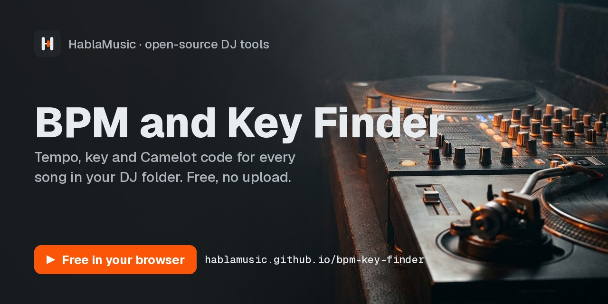

<div align="center">

<a href="https://hablamusic.github.io/bpm-key-finder/es/"></a>

[](LICENSE)
[](package.json)
[](https://hablamusic.com/es/dj-tools?utm_source=github&utm_medium=readme&utm_campaign=bpm-key-finder)

**Detecta el BPM, la tonalidad y el código Camelot de cualquier canción, o de toda tu carpeta de DJ, desde la terminal. Sin instalar nada, sin subir archivos, sin dependencias.**

<a href="https://hablamusic.github.io/bpm-key-finder/es/"><b>▶ Pruébalo en tu navegador</b></a> · sin instalar, sin cuenta, sin subir nada

</div>

[English](README.md) · Español · [Português (BR)](README.pt-BR.md)

# Detector de BPM y tonalidad para DJ (CLI y JavaScript)

`bpm-key-finder` lee un archivo de audio (WAV sin nada más; MP3, FLAC, M4A, OGG y AIFF con ffmpeg), mide el tempo en BPM y la tonalidad, y la muestra como nombre (`A minor`, La menor), [código Camelot](https://hablamusic.com/es/learn/harmonic-mixing-camelot-wheel?utm_source=github&utm_medium=readme&utm_campaign=bpm-key-finder) (`8A`) y código Open Key (`1m`), junto con las tonalidades con las que combina. Si le das una carpeta, devuelve una tabla, un CSV o un JSON de todo el crate. Es JavaScript puro para Node 18+ sin paquetes, y el mismo código corre en el navegador: es el motor del [detector de BPM y tonalidad online gratis](https://hablamusic.com/es/dj-tools/bpm-key-finder?utm_source=github&utm_medium=readme&utm_campaign=bpm-key-finder) de HablaMusic.

## Empieza aquí: elige tu camino

| Eres… | Haz esto | Tiempo |
|---|---|---|
| DJ y nunca abriste una terminal | Abre la **[versión para navegador](https://hablamusic.github.io/bpm-key-finder/es/)**, suelta tus canciones y lee BPM, tonalidad y Camelot. También en el celular. | 10 segundos |
| Te va copiar y pegar | Instala [Node.js LTS](https://nodejs.org/es) una vez, abre Terminal (Mac) o PowerShell (Windows) y pega `npx github:hablamusic/bpm-key-finder ~/Music --sort camelot` | 2 minutos |
| Usas Claude Code, Cursor o Codex | `npx skills add hablamusic/bpm-key-finder` y pide *"saca el BPM y la tonalidad de las canciones de ~/Music"* | 1 minuto |

<p align="center"></p>

## Inicio rápido

```bash
# directo desde GitHub (necesita Node 18+)
npx github:hablamusic/bpm-key-finder ~/Music/crate --sort camelot

# o clónalo
git clone https://github.com/hablamusic/bpm-key-finder
cd bpm-key-finder
node bin/bpm-key-finder.js tema.wav
node bin/bpm-key-finder.js ~/Music/crate -r --csv > crate.csv
```

Para MP3 y otros formatos instala [ffmpeg](https://ffmpeg.org/download.html); la herramienta solo lo usa para decodificar.

## Resultado

Salida real con tres cumbias generadas con IA de la [guía de cumbia](https://hablamusic.com/es/genres/cumbia?utm_source=github&utm_medium=readme&utm_campaign=bpm-key-finder):

```text
$ bpm-key-finder genres-cumbia --sort bpm
file                 bpm  key      camelot  mixes with  confidence
-------------------  ---  -------  -------  ----------  ------------------
genres-cumbia/1.mp3  92   C minor  5A       4A 6A 5B    bpm high, key high
genres-cumbia/2.mp3  96   C minor  5A       4A 6A 5B    bpm high, key ok
genres-cumbia/3.mp3  100  A minor  8A       7A 9A 8B    bpm high, key high
```

Siguiente paso: pasa el CSV a [camelot-wheel](https://github.com/hablamusic/camelot-wheel) para ordenar el crate en un set armónico (`camelot set crate.csv`).

## Precisión: prueba con 19 temas generados con IA

Probamos la herramienta con 19 temas generados con Google Lyria en hablamusic.com (bachata, corridos, cumbia, dembow, trap latino, reggaetón; previews de 30 segundos) y la comparamos con [essentia](https://essentia.upf.edu/) 2.1, la librería open source del Music Technology Group (UPF, Barcelona). Datos completos: [`benchmark/ai-tracks.json`](benchmark/ai-tracks.json).

| Prueba | Resultado |
|---|---|
| BPM a menos de 1 del de essentia | 17 de 19 |
| Misma tonalidad que essentia | 9 de 19 |
| Tonalidad compatible para mezclar con la de essentia (igual, ±1 o relativa en la rueda Camelot) | 15 de 19 |
| BPM a menos de 2 del tempo escrito en el prompt | 18 de 19 |
| Tonalidad igual a la del prompt | 1 de 19 (essentia: 0 de 19) |

1. **Detectar la tonalidad es lo difícil.** Incluso dos buenos detectores coinciden en la tonalidad exacta solo la mitad de las veces en temas densos y cortos; casi todas las diferencias son vecinas en la rueda, que igual combinan. Si la confianza dice `low`, confía en tu oído y revisa las alternativas en `--json`.
2. **La IA respeta el BPM que pides, no la tonalidad.** Lyria clavó el tempo casi siempre y la tonalidad pedida una vez de 19. Si generas herramientas de DJ con IA, analiza el resultado antes de etiquetarlo.

Fallo conocido: un dembow (prompt 115 BPM, essentia 114,9) salió como 92 BPM. Las baterías sincopadas y escasas pueden engañar a la autocorrelación.

## Preguntas frecuentes

**¿Cómo saco el BPM y la tonalidad de una canción?**
`npx github:hablamusic/bpm-key-finder cancion.mp3`. Sin terminal: arrastra el archivo al [detector online](https://hablamusic.com/es/dj-tools/bpm-key-finder?utm_source=github&utm_medium=readme&utm_campaign=bpm-key-finder), que usa el mismo código en tu navegador y no sube el archivo.

**¿Qué es el código Camelot?**
Un nombre para cada una de las 24 tonalidades: del 1 al 12 en una rueda, A para menor y B para mayor. Dos temas combinan si tienen el mismo código, un número de diferencia con la misma letra, o el mismo número con la otra letra.

**¿Por qué Rekordbox, Serato o Mixed In Key dan otra tonalidad?**
Cada detector usa perfiles y ventanas distintas; la relativa mayor/menor (8A vs 8B) y la quinta (8A vs 9A) son las diferencias habituales, y ambas lecturas combinan entre sí.

**¿Sube mi música a algún sitio?**
No. Todo corre en tu equipo.

## Relacionado

- [camelot-wheel](https://github.com/hablamusic/camelot-wheel): rueda Camelot, tonalidades compatibles, mashups y orden del set.
- [awesome-ai-dj-prompts](https://github.com/hablamusic/awesome-ai-dj-prompts): prompts de IA para intros, outros y bases de remix.
- Herramientas online: [detector de BPM y tonalidad](https://hablamusic.com/es/dj-tools/bpm-key-finder?utm_source=github&utm_medium=readme&utm_campaign=bpm-key-finder) · [creador de mashups](https://hablamusic.com/es/dj-tools/mashup-maker?utm_source=github&utm_medium=readme&utm_campaign=bpm-key-finder) · [quitavoces](https://hablamusic.com/es/dj-tools/vocal-remover?utm_source=github&utm_medium=readme&utm_campaign=bpm-key-finder)
- Guías: [cómo sincronizar temas](https://hablamusic.com/es/learn/how-to-beatmatch?utm_source=github&utm_medium=readme&utm_campaign=bpm-key-finder) · [cómo hacer un mashup](https://hablamusic.com/es/learn/how-to-make-a-mashup?utm_source=github&utm_medium=readme&utm_campaign=bpm-key-finder)

## Licencia

MIT. Hecho por [HablaMusic](https://hablamusic.com/es?utm_source=github&utm_medium=readme&utm_campaign=bpm-key-finder), generador de música con IA con herramientas de DJ gratis en el navegador.

## Autor

Creado por **Vlad Yasinski**, consultor de crecimiento con IA ([roimobi.com](https://www.roimobi.com/?utm_source=github&utm_medium=readme&utm_campaign=bpm-key-finder) · [LinkedIn](https://www.linkedin.com/in/vlad-yasinski-ua5er/)), como parte de [HablaMusic](https://hablamusic.com/es?utm_source=github&utm_medium=readme&utm_campaign=bpm-key-finder). Más herramientas DJ gratis: [github.com/hablamusic](https://github.com/hablamusic) · [hablamusic.github.io](https://hablamusic.github.io/).
