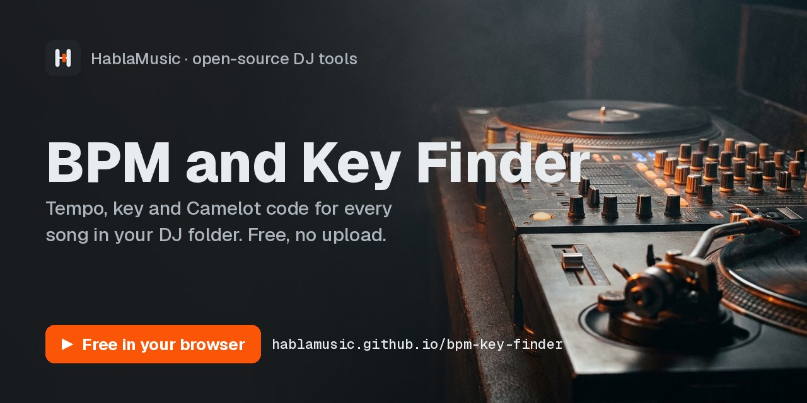

<div align="center">

<a href="https://hablamusic.github.io/bpm-key-finder/"></a>

[](LICENSE)
[](#quickstart)
[](package.json)
[](#use-it-from-an-ai-agent)
[](https://hablamusic.com/dj-tools?utm_source=github&utm_medium=readme&utm_campaign=bpm-key-finder)

**Find the BPM, musical key and Camelot code of any song, or of a whole DJ folder, from the command line. No install, no upload, no dependencies.**

<a href="https://hablamusic.github.io/bpm-key-finder/"><b>▶ Try it in your browser</b></a> · no install, no signup, nothing uploaded

[Quickstart](#quickstart) · [Output](#what-you-get) · [Accuracy](#accuracy-tested-on-19-ai-generated-tracks) · [How it works](#how-it-works) · [Library](#use-it-as-a-library) · [FAQ](#faq)

</div>

English · [Español](README.es.md) · [Português (BR)](README.pt-BR.md)

# BPM and Key Finder: tempo, key and Camelot code for DJs

`bpm-key-finder` reads an audio file (WAV natively; MP3, FLAC, M4A, OGG, AIFF through ffmpeg), measures its tempo in BPM and its musical key, and prints the key as a name (`A minor`), a [Camelot code](https://hablamusic.com/learn/harmonic-mixing-camelot-wheel?utm_source=github&utm_medium=readme&utm_campaign=bpm-key-finder) (`8A`) and an Open Key code (`1m`), plus the keys it mixes with. Point it at a folder and you get a table, CSV or JSON for the whole crate. It is plain JavaScript for Node 18+ with zero packages, and the same code runs in the browser: it is the engine behind the free [online BPM and key finder](https://hablamusic.com/dj-tools/bpm-key-finder?utm_source=github&utm_medium=readme&utm_campaign=bpm-key-finder) on HablaMusic.

| **One file or a whole crate** | **Camelot out of the box** | **Nothing leaves your machine** |
|:---|:---|:---|
| Give it files or folders (`-r` for sub-folders). Sort by BPM or Camelot, export CSV for Rekordbox/Serato prep sheets or JSON for scripts. | Every result carries the key name, Camelot code, Open Key code and the four keys that mix cleanly (same, +1, -1, relative). | Audio is decoded locally. No account, no API, no upload, no telemetry. |

## Start here: pick your way

| You are… | Do this | Time |
|---|---|---|
| A DJ who never opened a terminal | Open the **[browser version](https://hablamusic.github.io/bpm-key-finder/)**, drop your songs, read BPM, key and Camelot. Works on phones too. | 10 seconds |
| Fine with copy and paste | Install [Node.js LTS](https://nodejs.org/) once, open Terminal (Mac) or PowerShell (Windows), paste `npx github:hablamusic/bpm-key-finder ~/Music --sort camelot` | 2 minutes |
| Using Claude Code, Cursor or Codex | `npx skills add hablamusic/bpm-key-finder`, then ask *"find the BPM and key of the songs in ~/Music"* | 1 minute |

<p align="center"></p>

## Quickstart

```bash
# run straight from GitHub (needs Node 18+)
npx github:hablamusic/bpm-key-finder ~/Music/crate --sort camelot

# or clone it
git clone https://github.com/hablamusic/bpm-key-finder
cd bpm-key-finder
node bin/bpm-key-finder.js track.wav
node bin/bpm-key-finder.js ~/Music/crate -r --csv > crate.csv
```

WAV works without anything else. For MP3 and other formats install [ffmpeg](https://ffmpeg.org/download.html) (`brew install ffmpeg`, `winget install ffmpeg`, `apt install ffmpeg`); the tool calls it only to decode.

## What you get

Real output on three AI-generated cumbia tracks from the [HablaMusic cumbia page](https://hablamusic.com/es/genres/cumbia?utm_source=github&utm_medium=readme&utm_campaign=bpm-key-finder):

```text
$ bpm-key-finder genres-cumbia --sort bpm
file                 bpm  key      camelot  mixes with  confidence
-------------------  ---  -------  -------  ----------  ------------------
genres-cumbia/1.mp3  92   C minor  5A       4A 6A 5B    bpm high, key high
genres-cumbia/2.mp3  96   C minor  5A       4A 6A 5B    bpm high, key ok
genres-cumbia/3.mp3  100  A minor  8A       7A 9A 8B    bpm high, key high
```

`--csv` gives `file,bpm,key,camelot,open_key,bpm_conf,key_conf,duration`. `--json` adds the two runner-up keys for each track, useful when the confidence is low.

Next step: feed the CSV to [camelot-wheel](https://github.com/hablamusic/camelot-wheel) to order the crate into a harmonic set (`camelot set crate.csv`).

## Accuracy: tested on 19 AI-generated tracks

We ran the tool on 19 tracks generated with Google Lyria on hablamusic.com (bachata, corridos, cumbia, dembow, latin trap, reggaeton; 30-second previews) and compared it with [essentia](https://essentia.upf.edu/) 2.1, the open-source audio library from the Music Technology Group (UPF Barcelona), using its EDM key profile. Full data: [`benchmark/ai-tracks.json`](benchmark/ai-tracks.json).

| Check | Result |
|---|---|
| BPM within 1 of essentia | 17 of 19 |
| Same key as essentia | 9 of 19 |
| Key mix-compatible with essentia's (same, ±1 or relative on the Camelot wheel) | 15 of 19 |
| BPM within 2 of the tempo written in the prompt | 18 of 19 |
| Key equal to the key written in the prompt | 1 of 19 (essentia: 0 of 19) |

Two takeaways for DJs:

1. **Key detection is the hard part.** Even two good detectors agree on the exact key only about half the time on dense, short club tracks; most disagreements are neighbours on the wheel (a fifth apart, or relative major/minor), which still mix. When the confidence says `low`, trust your ears and check the runner-up keys in `--json`.
2. **AI music models follow the BPM you ask for, not the key.** Lyria hit the requested tempo almost every time but landed on the requested key once in 19. If you generate DJ tools with AI, analyse the result before you tag it.

Known miss: one dembow track (prompt 115 BPM, essentia 114.9) read as 92 BPM. Sparse, syncopated drums can pull the autocorrelation to a wrong period; check tempos far from the genre's usual range.

## How it works

1. **Decode** to mono and resample to 11,025 Hz; analyse up to 120 seconds from the middle of the track (`--max-sec` to change).
2. **Tempo**: spectral flux (frame-to-frame rise in a log spectrum, with extra weight below ~320 Hz for kick and bass) gives an onset curve. Its autocorrelation is scored over 60-200 BPM together with 2× and 4× the period, with a mild preference for club tempos, refined to a fraction of a frame and folded into 78-175 BPM.
3. **Key**: a 12-bin chroma vector (60-2100 Hz, 8192-point FFT) is averaged over the track and correlated with the Krumhansl-Kessler major and minor key profiles for all 12 tonics. The best of the 24 wins; the gap to the runner-up is the confidence.
4. **Camelot**: the key maps to the Camelot wheel (minor = A, major = B) and to Open Key notation, and the four compatible codes are listed.

```
audio ──► mono 11 kHz ──► spectral flux ──► autocorrelation ──► BPM
                    └───► chroma (12 bins) ──► 24 key profiles ──► key ──► Camelot 8A / Open Key 1m
```

## Use it as a library

```js
import { analyze } from "./src/analyze.js";      // pure JS, also works in the browser
import { decodeFile } from "./src/decode.js";    // Node only

const { samples, sampleRate } = decodeFile("track.mp3");
const r = analyze(samples, sampleRate);
console.log(r.bpm, r.key.name, r.key.camelot);    // 124 "A minor" "8A"
```

In the browser, decode with the Web Audio API (`AudioContext.decodeAudioData`), mix the channels to mono and pass the `Float32Array` and its sample rate to `analyze`.

## Use it from an AI agent

The repo is a skill for Claude Code and works as a Cursor rule or a Codex `AGENTS.md` snippet. Ask "find the BPM and key of the tracks in ~/Music/crate and sort them for a harmonic set" and the agent runs the CLI and explains the Camelot moves.

```bash
# Claude Code
git clone https://github.com/hablamusic/bpm-key-finder ~/.claude/skills/bpm-key-finder
# Cursor: copy .cursor/rules/bpm-key-finder.mdc into your project's .cursor/rules/
# Codex: paste codex/INSTRUCTIONS.md into your AGENTS.md
```

## FAQ

**How do I find the BPM and key of a song?**
Run `npx github:hablamusic/bpm-key-finder song.mp3`. If you would rather not use a terminal, drop the file into the [online BPM and key finder](https://hablamusic.com/dj-tools/bpm-key-finder?utm_source=github&utm_medium=readme&utm_campaign=bpm-key-finder); it runs the same code in your browser and does not upload the file.

**What is the Camelot code?**
A DJ-friendly name for each of the 24 keys: 1 to 12 around a wheel, A for minor and B for major. Tracks mix in key when their codes are equal, one number apart with the same letter, or the same number with the other letter. The [Camelot wheel guide](https://hablamusic.com/learn/harmonic-mixing-camelot-wheel?utm_source=github&utm_medium=readme&utm_campaign=bpm-key-finder) has the full chart.

**Why does it say 70 BPM when the track feels like 140?**
It doesn't: results are folded into 78-175 BPM. Trap, drill and corridos tumbados are written at 130-150 BPM but feel half-time; the tool reports the written tempo. Use half or double if your software counts the other way.

**Why do Rekordbox, Serato or Mixed In Key show a different key?**
Each detector uses different profiles and windows, and relative major/minor (8A vs 8B) and fifths (8A vs 9A) are the usual disagreements. Both readings mix with each other, so the practical difference is small.

**Does it upload my music?**
No. Decoding and analysis run on your machine. The only external program it calls is your local ffmpeg, for non-WAV files.

**Which formats are supported?**
WAV (8/16/24/32-bit integer, 32/64-bit float, mono or multichannel) without dependencies; anything ffmpeg can read with ffmpeg installed.

## Related

- [camelot-wheel](https://github.com/hablamusic/camelot-wheel): key converter, compatible keys, mashup checker and set planner.
- [awesome-ai-dj-prompts](https://github.com/hablamusic/awesome-ai-dj-prompts): prompts for AI-generated DJ intros, outros and remix beds, with BPM and key.
- Online tools: [BPM and key finder](https://hablamusic.com/dj-tools/bpm-key-finder?utm_source=github&utm_medium=readme&utm_campaign=bpm-key-finder) · [mashup maker](https://hablamusic.com/dj-tools/mashup-maker?utm_source=github&utm_medium=readme&utm_campaign=bpm-key-finder) · [vocal remover](https://hablamusic.com/dj-tools/vocal-remover?utm_source=github&utm_medium=readme&utm_campaign=bpm-key-finder)
- Guides: [how to beatmatch](https://hablamusic.com/learn/how-to-beatmatch?utm_source=github&utm_medium=readme&utm_campaign=bpm-key-finder) · [how to make a mashup](https://hablamusic.com/learn/how-to-make-a-mashup?utm_source=github&utm_medium=readme&utm_campaign=bpm-key-finder)

## License

MIT. Made by [HablaMusic](https://hablamusic.com/?utm_source=github&utm_medium=readme&utm_campaign=bpm-key-finder), an AI music generator with free in-browser DJ tools in English, Spanish and Portuguese. Issues and pull requests are welcome: see [CONTRIBUTING.md](CONTRIBUTING.md).

## Author

Built by **Vlad Yasinski**, AI growth consultant ([roimobi.com](https://www.roimobi.com/?utm_source=github&utm_medium=readme&utm_campaign=bpm-key-finder) · [LinkedIn](https://www.linkedin.com/in/vlad-yasinski-ua5er/)), as part of [HablaMusic](https://hablamusic.com/?utm_source=github&utm_medium=readme&utm_campaign=bpm-key-finder). More free DJ tools: [github.com/hablamusic](https://github.com/hablamusic) · [hablamusic.github.io](https://hablamusic.github.io/).
