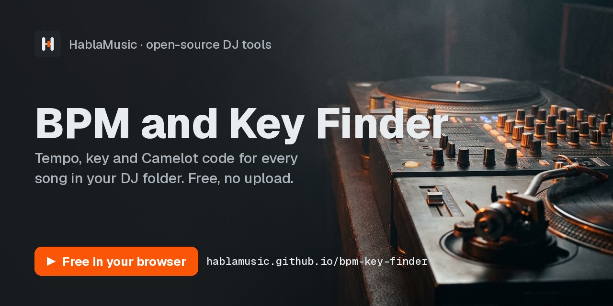

<div align="center">

<a href="https://hablamusic.github.io/bpm-key-finder/pt/"></a>

[](LICENSE)
[](package.json)
[](https://hablamusic.com/pt/dj-tools?utm_source=github&utm_medium=readme&utm_campaign=bpm-key-finder)

**Descubra o BPM, o tom e o código Camelot de qualquer música, ou da pasta de DJ inteira, pelo terminal. Sem instalar nada, sem upload, sem dependências.**

<a href="https://hablamusic.github.io/bpm-key-finder/pt/"><b>▶ Teste no navegador</b></a> · sem instalar, sem conta, sem upload

</div>

[English](README.md) · [Español](README.es.md) · Português (BR)

# Detector de BPM e tom para DJ (CLI e JavaScript)

O `bpm-key-finder` lê um arquivo de áudio (WAV direto; MP3, FLAC, M4A, OGG e AIFF com ffmpeg), mede o tempo em BPM e o tom, e mostra o tom como nome (`A minor`, Lá menor), [código Camelot](https://hablamusic.com/pt/learn/harmonic-mixing-camelot-wheel?utm_source=github&utm_medium=readme&utm_campaign=bpm-key-finder) (`8A`) e código Open Key (`1m`), junto com os tons que combinam. Com uma pasta, ele devolve tabela, CSV ou JSON do crate inteiro. É JavaScript puro para Node 18+ sem pacotes, e o mesmo código roda no navegador: é o motor do [detector de BPM e tom online grátis](https://hablamusic.com/pt/dj-tools/bpm-key-finder?utm_source=github&utm_medium=readme&utm_campaign=bpm-key-finder) da HablaMusic.

## Comece aqui: escolha seu caminho

| Você é… | Faça isto | Tempo |
|---|---|---|
| DJ e nunca abriu um terminal | Abra a **[versão no navegador](https://hablamusic.github.io/bpm-key-finder/pt/)**, solte suas músicas e veja BPM, tom e Camelot. Funciona no celular. | 10 segundos |
| Tranquilo com copiar e colar | Instale o [Node.js LTS](https://nodejs.org/pt) uma vez, abra o Terminal (Mac) ou PowerShell (Windows) e cole `npx github:hablamusic/bpm-key-finder ~/Music --sort camelot` | 2 minutos |
| Usa Claude Code, Cursor ou Codex | `npx skills add hablamusic/bpm-key-finder` e peça *"descubra o BPM e o tom das músicas em ~/Music"* | 1 minuto |

<p align="center"></p>

## Começo rápido

```bash
npx github:hablamusic/bpm-key-finder ~/Music/crate --sort camelot

git clone https://github.com/hablamusic/bpm-key-finder
cd bpm-key-finder
node bin/bpm-key-finder.js faixa.wav
node bin/bpm-key-finder.js ~/Music/crate -r --csv > crate.csv
```

Para MP3 e outros formatos, instale o [ffmpeg](https://ffmpeg.org/download.html); a ferramenta só usa ele para decodificar.

## Precisão: teste com 19 faixas geradas por IA

Testamos com 19 faixas geradas pelo Google Lyria no hablamusic.com (bachata, corridos, cumbia, dembow, trap latino, reggaeton; prévias de 30 segundos) e comparamos com o [essentia](https://essentia.upf.edu/) 2.1, biblioteca open source do Music Technology Group (UPF, Barcelona). Dados: [`benchmark/ai-tracks.json`](benchmark/ai-tracks.json).

| Teste | Resultado |
|---|---|
| BPM a menos de 1 do essentia | 17 de 19 |
| Mesmo tom do essentia | 9 de 19 |
| Tom compatível para mixar com o do essentia (igual, ±1 ou relativo na roda Camelot) | 15 de 19 |
| BPM a menos de 2 do tempo pedido no prompt | 18 de 19 |
| Tom igual ao pedido no prompt | 1 de 19 (essentia: 0 de 19) |

Conclusão para DJs: a IA respeita o BPM que você pede, mas não o tom. Meça o tom antes de mixar. Quando a confiança for `low`, confira as alternativas no `--json`.

## Perguntas frequentes

**Como descobrir o BPM e o tom de uma música?**
`npx github:hablamusic/bpm-key-finder musica.mp3`. Sem terminal: arraste o arquivo para o [detector online](https://hablamusic.com/pt/dj-tools/bpm-key-finder?utm_source=github&utm_medium=readme&utm_campaign=bpm-key-finder), que roda o mesmo código no navegador sem enviar o arquivo.

**O que é o código Camelot?**
Um nome para cada um dos 24 tons: de 1 a 12 numa roda, A para menor e B para maior. Duas faixas combinam com o mesmo código, um número de diferença com a mesma letra, ou o mesmo número com a outra letra.

**Minhas músicas são enviadas para algum lugar?**
Não. Tudo roda no seu computador.

## Relacionado

- [camelot-wheel](https://github.com/hablamusic/camelot-wheel) · [awesome-ai-dj-prompts](https://github.com/hablamusic/awesome-ai-dj-prompts)
- Online: [detector de BPM e tom](https://hablamusic.com/pt/dj-tools/bpm-key-finder?utm_source=github&utm_medium=readme&utm_campaign=bpm-key-finder) · [criador de mashups](https://hablamusic.com/pt/dj-tools/mashup-maker?utm_source=github&utm_medium=readme&utm_campaign=bpm-key-finder) · [removedor de voz](https://hablamusic.com/pt/dj-tools/vocal-remover?utm_source=github&utm_medium=readme&utm_campaign=bpm-key-finder)
- Guias: [como sincronizar batidas](https://hablamusic.com/pt/learn/how-to-beatmatch?utm_source=github&utm_medium=readme&utm_campaign=bpm-key-finder) · [como fazer um mashup](https://hablamusic.com/pt/learn/how-to-make-a-mashup?utm_source=github&utm_medium=readme&utm_campaign=bpm-key-finder)

## Licença

MIT. Feito pela [HablaMusic](https://hablamusic.com/pt?utm_source=github&utm_medium=readme&utm_campaign=bpm-key-finder), gerador de música com IA com ferramentas de DJ grátis no navegador.

## Autor

Criado por **Vlad Yasinski**, consultor de crescimento com IA ([roimobi.com](https://www.roimobi.com/?utm_source=github&utm_medium=readme&utm_campaign=bpm-key-finder) · [LinkedIn](https://www.linkedin.com/in/vlad-yasinski-ua5er/)), como parte da [HablaMusic](https://hablamusic.com/pt?utm_source=github&utm_medium=readme&utm_campaign=bpm-key-finder). Mais ferramentas de DJ grátis: [github.com/hablamusic](https://github.com/hablamusic) · [hablamusic.github.io](https://hablamusic.github.io/).
